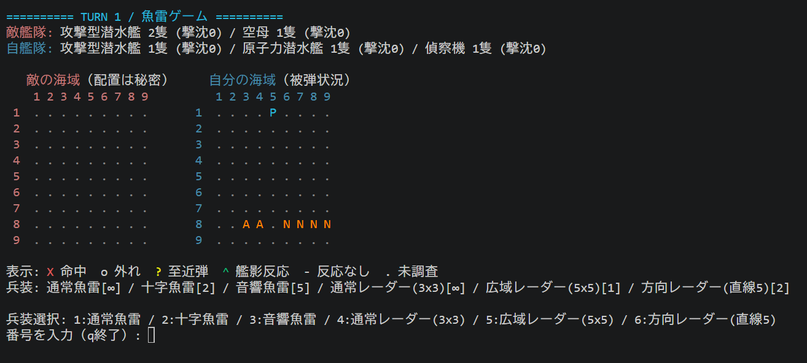
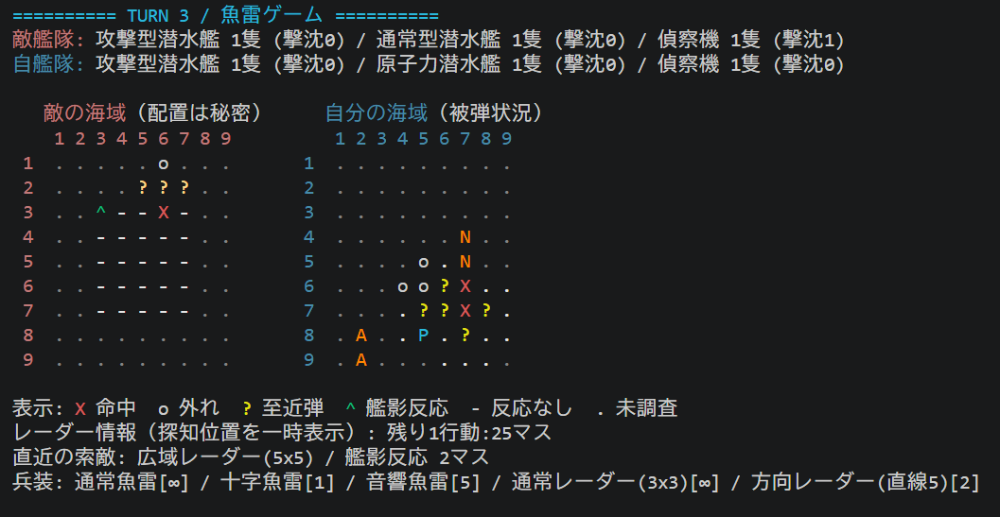
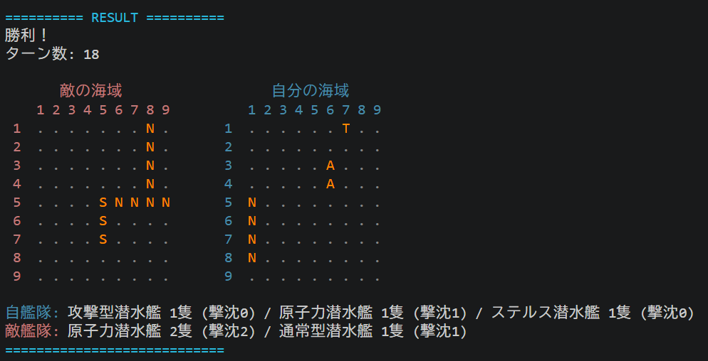

# 魚雷ゲーム（torpedo_game）

## ゲームの概要

ターミナル上で遊ぶ、ターン制の海戦ゲームです。6種類の艦種から2〜3隻を選び、9×9マスの海域に配置してCPUと対戦します。同じ艦種を複数選ぶこともできます。

敵艦隊の構成は公開されていますが、配置は隠されています。魚雷の命中・至近弾やレーダーの情報を手掛かりに、敵の位置を推理します。相手の艦をすべて撃沈するか、攻撃手段を失わせると勝利です。自艦隊が同じ状態になると敗北します。

## 動作環境

- Python 3.10以降（これまでの動作確認にはPython 3.12を使用）
- 日本語とANSIカラー表示に対応したターミナル
- WindowsではWindows TerminalやVS Codeの統合ターミナルなどを使用
- 外部パッケージ不要（Python標準ライブラリのみ）

## インストール方法

1. Pythonをインストールします。
2. このリポジトリをダウンロードして展開するか、Gitで取得します。

   ```sh
   git clone https://github.com/Akimori-Kento/torpedo_game.git
   cd torpedo_game
   ```

ZIPで取得した場合は、展開したフォルダーをターミナルで開いてください。追加のパッケージをインストールする必要はありません。

## 起動方法

通常の対戦を開始します。

```sh
python torpedo_game.py
```

利用できるオプションは次のとおりです。

| オプション | 内容 |
| --- | --- |
| `--no-animations` | 演出の待ち時間を省略 |
| `--seed 42` | 乱数シードを指定して動作確認 |
| `--demo` | 入力なしで自動対戦 |
| `--debug 4` | 4×4の検証用海域。敵は固定配置・配置公開・反撃なし |
| `--debug 5` / `--debug 6` | 5×5または6×6の検証用海域 |
| `--help` | オプション一覧を表示 |

```sh
python torpedo_game.py --no-animations
python torpedo_game.py --demo --seed 42
python torpedo_game.py --debug 5 --no-animations
```

`--demo` と `--debug` は同時に指定できません。環境に応じて、`python` を `python3` や `py` に読み替えてください。

## 操作方法

1. 艦種の番号を空白で区切り、2〜3隻選びます（例：`1 3 4`）。
2. 配置方法を選びます。Enterまたは`a`で自動配置、`m`で手動配置です。
3. 手動配置では、艦の左上の座標を「列 行」で入力します（例：`3 5`）。回転は`y`で指定します。
4. 使用する兵装の番号を選び、目標座標を「列 行」で入力します。
5. 行動後、EnterでCPUの反撃へ進みます。

| 入力 | 内容 |
| --- | --- |
| `3 5` | 3列目・5行目を指定。座標は1から数える |
| `w` / `a` / `s` / `d` | 方向レーダーの探索方向：上・左・下・右 |
| `b` | 目標座標や探索方向の入力中に兵装選択へ戻る |
| `q` | 艦隊選択・兵装選択・座標入力中に終了 |
| `Ctrl+C` | ゲームを終了 |

二連装魚雷では目標座標を2回入力します。対戦終了後は`y`で再プレイできます。

| 盤面の記号 | 意味 |
| --- | --- |
| `A` / `S` / `N` / `T` | 攻撃型・通常型・原子力・ステルス潜水艦 |
| `C` / `P` | 空母・偵察機 |
| `X` | 命中・撃沈 |
| `o` | 外れ |
| `?` | 至近弾 |
| `^` / `-` | レーダーの艦影反応あり・反応なし |
| `.` | 未調査。至近弾の候補マスは白く表示 |

空母・偵察機は索敵用で、攻撃能力がありません。支援艦だけの編成は戦闘開始時に敗北します。レーダー情報は探索後の自分の行動2回まで表示されます。

## 追加・改良した機能

### 改良機能01：ステルス潜水艦の追加

- 1×1マスの潜水艦で、通常魚雷を使用します。
- レーダーでは探知されません。
- 魚雷による命中・至近弾の判定には含まれます。

### 改良機能02：音響魚雷の追加

- 原子力潜水艦が音響魚雷を5回使用できます。
- 着弾地点に艦がいれば命中します。外れた場合、着弾地点を中心とする5×5マスに生存艦がいれば至近弾になります。
- 通常魚雷の至近弾判定は3×3マスです。

### 改良機能03：CPUの行動パターンの改良

- レーダーで探知した座標、命中したマスの上下左右、至近弾の周辺の順に攻撃候補を優先します。
- レーダーで探知した座標や命中地点の周辺を狙う場合は、攻撃用の兵装を選びます。それ以外では、レーダーを選ぶ確率を高めて索敵します。
- 至近弾の周辺を狙う範囲は兵装に合わせ、通常魚雷なら3×3、音響魚雷なら5×5にします。
- 外れた地点の感知範囲は攻撃優先度を下げ、ほかに候補がなくなったときに再び候補にします。
- 攻撃済みの座標を記録し、同じマスへの重複攻撃を避けます。

### 改良機能04：生存艦だけを対象にした至近弾判定

- 至近弾の判定では、生存している艦の座標だけを調べます。
- 撃沈済みの艦だけが感知範囲内にある場合は、外れになります。

### 改良機能05：至近弾の候補座標の管理

- `Nearmiss` クラスで至近弾ごとの感知範囲と候補座標を管理します。
- 攻撃済みの座標は候補から除きます。
- 候補を減らしても最初の感知範囲を保持し、撃沈した艦との関連を判定できるようにしています。

### 改良機能06：至近弾の候補マスの強調表示

- 未攻撃の候補マスを白い `.` で表示します。
- 実際の敵艦の座標ではなく、至近弾から考えられる候補を表示します。
- 複数の至近弾がある場合は、それぞれの候補をまとめて表示します。

### 改良機能07：撃沈に応じた至近弾の表示更新

- 通常の至近弾は黄色で表示します。
- 感知範囲内の艦が撃沈されると、対応する至近弾を淡い黄色に変え、その至近弾の候補を消去します。
- プレイヤー・CPUの両方の攻撃で更新します。

### 改良機能08：自艦隊・敵艦隊の色分け

- 自艦隊の見出し・座標は深い青、敵艦隊は深い赤で表示します。
- 行番号と列番号にも色を付け、2つの海域を見分けやすくしています。

### 改良機能09：サーチ範囲内の艦の色変更

- サーチ範囲内の表示中の艦は、元の色に応じて色を変更します。
- オレンジの潜水艦は黄緑、シアンの空母・偵察機は青緑になります。
- 通常モードでは、隠れている敵艦の記号は表示しません。

### 改良機能10：同じ艦種を複数選んだときの弾数の修正

- 同じ艦種を複数編成しても、使用できる弾数が増えない問題を修正しました。
- 弾数を艦ごとに管理し、生存している艦の残弾数を合計して表示します。
- 例えば、音響魚雷を5発持つ原子力潜水艦を2隻編成すると、合計10発使用できます。
- 1隻の弾を使い切った後は、同じ兵装を持つ別の生存艦の弾を消費します。撃沈された艦の残弾は使用できません。

### 改良機能11：リザルト画面の追加

- 対戦終了時に、勝敗と終了までにかかったターン数を表示します。
- 自艦隊と敵艦隊の配置を並べて表示し、対戦中は隠れていた敵艦の位置を確認できます。
- 両艦隊の艦種ごとの隻数と撃沈数を表示し、対戦結果を振り返れるようにしました。

## スクリーンショット
開始盤面

試合中

リザルト



## 既知の問題・制限事項

- CPUの未攻撃マスがすべてレーダーの「反応なし」になった場合、CPUが行動を繰り返しスキップし、レーダー情報の期限も進まなくなる場合があります。
- 開始時の至近弾の案内は「周囲8マス」と表示されますが、音響魚雷では周囲24マスを判定します。
- 撃沈時は、その艦が感知範囲に入っていた至近弾の候補全体を消去します。範囲内に別の生存艦がいても、その至近弾の候補表示は終了します。
- 同じ座標が別の至近弾の候補にも含まれる場合、その候補表示は残ります。
- 攻撃済みのマスへの再攻撃はできません。
- ANSIカラーに未対応の環境では、色や制御文字が正しく表示されない場合があります。暗い配色は背景によって見えにくくなります。
- デバッグモードは敵が反撃しないため、通常対戦とはルールが異なります。

## クレジット

- 最終課題として、既存のゲームをもとに機能を追加・改良しています。
- リポジトリ：[Akimori-Kento/torpedo_game](https://github.com/Akimori-Kento/torpedo_game)
- 使用技術：Python標準ライブラリ、ANSIエスケープシーケンス
